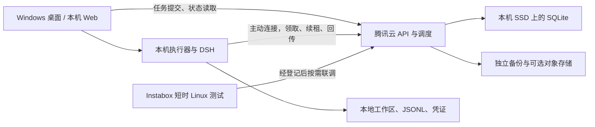

# Panoptic Super 云端调度与本地执行方案

状态：2026-11-22 设计提案。适用范围为个人使用、桌面与 Web 界面、模型走 API、Windows 本地执行为主。服务器规格和容量阈值是首轮验证的起点。

## 现状与实施顺序

本地 P1 和云端试验分阶段推进。当前实现支持恢复项目主对话和计划，跨机器调度仍待实现。本地任务可重启读回后，可以用合成任务验证云端持久化。真实写任务以本地崩溃恢复验收为前提。参见 [P1 发布定义](p1-release.md)、[现有任务图](../PLAN.md)和[远程运行时草案](runtime.md#6-远程运行时预留)。

| 已有实现 | 本项目如何复用 | 仍需实现 |
|---|---|---|
| DSH profiles、桌面/Web Host | 沿用现有入口、界面、模型路由、工具、审批和沙箱 | 项目与任务页面，云队列状态 |
| `storage-domain`、默认 JSON 后端、可选 SQLite 后端 | 项目域先使用明确版本的记录和存储接口 | 云端任务领取、租约与事件落库的原子事务 |
| 默认 Session JSONL 持久化、恢复和历史格式支持 | 本机保留完整会话，任务关联 Session ID | 跨机器任务状态与检查点索引，按需同步选定数据 |
| `jobs-local`、本机定时任务及 SDK stdio 接口 | 复用本机执行、事件订阅、取消和审批机制 | 已认证的远端任务传输与恢复协议 |

默认组合以 [base 配置](../../packages/bundle/base/cordis.patch.yml)为准。SQLite 是可选存储能力。[会话 JSONL](../../packages/session/session-persistence-jsonl/README.md)拥有会话文件。[DeepSeek Session 上报插件](../../packages/session/session-log-deepseek/README.md)用于模型提供方请求扩展。

## 部署与资源

| 节点 | 资源与可用性 | 角色 |
|---|---|---|
| Windows 本机 | 开发工作区和日常主执行器 | Panoptic Desktop/Web、DSH、项目文件、真实工具、模型 API 密钥、完整 JSONL、待上传事件 |
| 腾讯云北京轻量 | 2 vCPU、4 GB、60 GB SSD。截图显示已用 29.6 GB，名义剩余约 30 GB。锐驰套餐公网峰值 200 Mbps | 常驻轻量 API、定时调度、设备登记、SQLite 数据库、日志和备份任务 |
| Instabox | 4 vCPU、8 GiB、20 GiB 持久盘。截图显示空闲约 30 分钟暂停，当次运行上限 2 小时，可随使用增长到 8 小时 | 按需 Linux 构建、测试、打包、跨地域连通性与故障恢复演练。后续可加入显式选择的短任务执行器 |

腾讯云先使用当前 Ubuntu，部署前用 `cat /etc/os-release`、`uname -m`、`df -h`、`free -h` 和 `systemctl --type=service --state=running` 检查版本、架构、磁盘、内存与服务。需要重建时采用官方 Ubuntu Server 24.04 LTS x86_64。用一个轻量 DSH profile 装配调度与 HTTP 服务，由 systemd 拉起，数据库放同机 SSD，使用独立服务账号和数据目录。Linux 发布产物可从经过验证的构建环境上传。当前仓库 Node 版本为 24.15.0，pnpm 为 11.28.5。参见 [DSH 应用启动约定](../../docs/architecture.md#application-launch)。

锐驰带宽按峰值预算。跨境双向链路在连接、断线重连及上传产物时实测。Instabox 每次启动后按实际剩余运行时间接任务，结束前先回传日志摘要和产物，检查点落在腾讯云。免费套餐条款限制人工保活动作，建议停用仅用于延长在线时间的定时请求。参见 [腾讯云实例套餐](https://cloud.tencent.cn/document/product/1207/44755)、[Ubuntu 生命周期](https://ubuntu.com/about/release-cycle)、[Instabox 机器状态](https://instabox.sh/docs/concepts)和[Instabox 服务条款](https://instabox.sh/terms)。

## 数据归属与连接方式

- 第一阶段本机拥有项目、任务、执行记录和会话。P2 启用云队列后，云端拥有该队列的任务、调度计划、租约、状态投影和已接收事件。本机拥有工作区、工具执行结果、完整会话与执行日志。用 `projectId`、`runId` 和 `sessionId` 建立关联。
- 云端先保存项目标识、任务摘要、运行状态和授权的检查点引用。附件或交付物按项目选择上传，较大产物进入对象存储，数据库记录哈希与引用。需要全文迁移时，再设计版本化导出、冲突处理及数据迁移。
- SQLite 由腾讯云服务进程在本机磁盘访问。工作端经应用 API 读写任务。应用一致的 SQLite 备份写入另一故障域，部署回滚先核对 schema 兼容性。参见 [SQLite WAL](https://sqlite.org/wal.html)与[在线备份 API](https://sqlite.org/backup.html)。
- 本机执行器主动连云端。个人联调先通过私有连接或 SSH 隧道访问服务。任务引用本机登记的工作区标识，执行器按登记路径和现有沙箱规则运行。执行器凭证限设备和项目，可单独撤销。模型密钥由执行端保管。需要对外绑定域名提供网站时，按腾讯云北京实例的备案要求部署。参见 [腾讯云备案说明](https://cloud.tencent.com/document/product/1207/45756)。

## 调度、断线和恢复

首个云端版本采用 HTTPS 请求和游标轮询。任务提交携带幂等键。执行器登记能力，按项目领取任务。云端在单个事务中写入尝试号、租约和任务状态。服务端时间判断租约期限，旧尝试号的事件只可用于人工对账，无法覆盖当前状态。先用现有 SDK 在独立测试目录验证事件、审批、取消和退出。集成桌面时，由拥有对应 Session 的本地 DSH 进程执行任务。SDK 联调使用独立 Harness home，确保一份会话只有一个写入者。参见 [TypeScript SDK](../../packages/sdk/client/README.md)与 [Agent Runtime 契约](../contracts/agent-runtime.md)。

| 场景 | 行为与可见状态 |
|---|---|
| 本机离线或关机 | 腾讯云仍收任务并持久排队，显示等待执行器 |
| 本机断网，运行还在进行 | 执行器持久保存已生成事件。续租失效后停止启动新步骤，保存进度并收敛在途调用 |
| 重连或重发事件 | 以运行、尝试号和事件序号去重。云端只确认已经落盘的连续游标，本机从确认位置续传 |
| 执行进程崩溃 | 从最近已验证检查点恢复。已提交副作用读取账本结果。未确认副作用进入待核对，查明结果后决定继续或重试 |
| 云端重启 | 从 SQLite 恢复队列和租约，以服务端时间重新判断。任务状态从数据库读取 |
| Instabox 暂停或停机 | 调度服务继续运行。短任务等待合规启动后恢复，也可重新执行只读验证。涉及本机路径或未确认写操作的任务保留原执行器与待核对状态 |
| 取消 | 停止领取或启动下一步。执行端调用 DSH 的取消与子进程清理，回传确认后显示已取消 |

项目写操作保持互斥。租约过期只表示协调端失去执行权证明。转派前需要原执行端确认释放，或核实原尝试已停止且写入结果可判定。执行账本在调用前写入意图，在结果持久化后标记提交。用同一幂等键结合实际副作用查询处理“写成功、回执丢失”。参见 [ADR-0010](../../docs/adr/ADR-0010-runtime-loops-and-execution-ledger.md)。

## 开发阶段与验收

| 阶段 | 开发范围 | 退出判据 |
|---|---|---|
| 0 基线 | 选定含所需本地改动的明确提交，隔离测试目录，记录依赖、构建、启动结果。读取腾讯云系统占用，明确现有服务 | `pnpm install --frozen-lockfile`、`pnpm run typecheck`、`pnpm run build` 通过。用 `pnpm dsh web` 验证当前启动入口。保存命令与提交号 |
| 1 本地 P1 | 项目与任务状态、单 agent 执行、审批、账本和检查点。先做单执行器的一条真实项目旅程 | 用测试仓库创建任务，只写指定文件，模拟“写完、结果确认前”和“确认后”两个崩溃点。重启后状态正确，已提交写入计数仍为 1，交付含测试结果。取消后没有遗留子进程 |
| 2 云端最小调度 | 在现有腾讯云部署协调服务和 SQLite。先接本地一个设备。完成提交、领取、续租、回传、取消和恢复 | 本机离线提交成功，上线后领取。重复提交得到同一任务。断线后按游标补齐。并发领取只有一个有效尝试。重启协调服务后队列可读。还原备份后记录数和样例校验一致 |
| 3 可选 Linux 验证节点 | 用 Instabox 验证 Linux 构建和短任务，随后按需注册为隔离的可选执行器 | 在一次正常暂停或停止演练后，腾讯云继续接受任务，运行标记可解释，恢复时没有重复写入。产物在停机前保存并核对哈希 |

阶段 1 可先按一至两周规划，阶段 2 按一至两周规划，进度取决于现有项目域复用程度和故障恢复测试。确认一个里程碑后再扩展到下一个。阶段 2 的初始容量验证采用一台设备、一个运行中的写任务、十个排队任务和一万条测试事件。记录 API 请求耗时、磁盘增长、内存、队列等待、断线重连与备份恢复耗时。初始告警可设为磁盘可用空间低于 10 GB、持续换页或调度响应明显变慢。按实测决定升级到 4 核 8 GB，或将大文件、日志归档和数据库分离。

以每天一次应用一致备份、每次发版前追加备份为首轮运维目标。保留一份独立于该实例的副本，并用新目录验证恢复。应用版本与迁移版本一起记录。数据库升级先在副本演练，失败时回到兼容的二进制与已验证数据库副本。

首轮产品交付以阶段 1 为准。阶段 2 分为 [CL-001 合成任务持久化验证](../tasks/CL-001.md)和 [CL-002 真实执行器接入](../tasks/CL-002.md)。前者可在本地任务持久化验收后开展，后者等待本地写入恢复通过。预算使用现有两台机器，模型开销单独按任务记录，出现连续重试、工具超时或超预算时将要执行的任务转为待处理状态。
