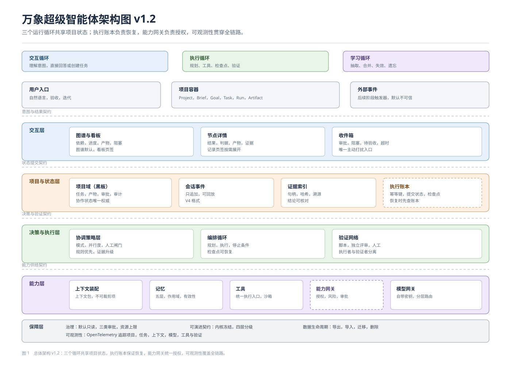
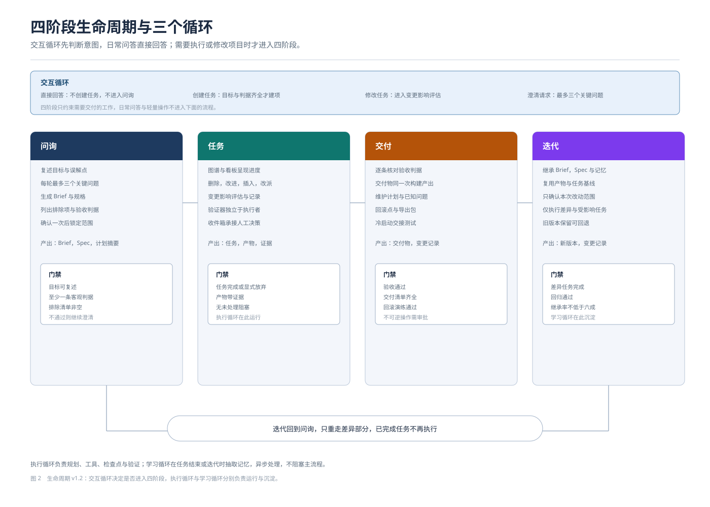
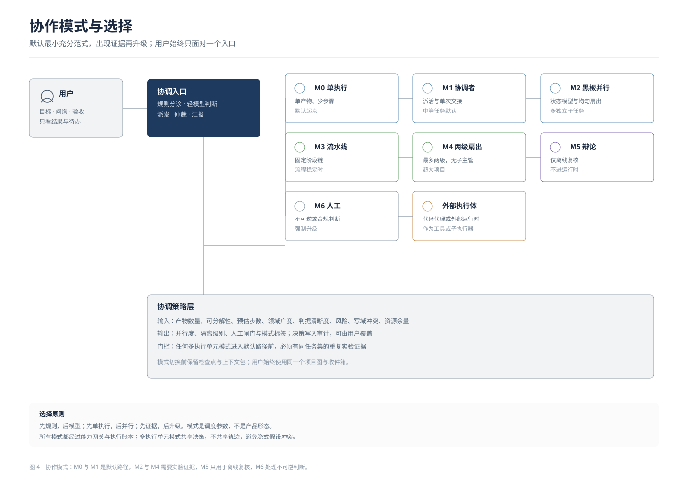
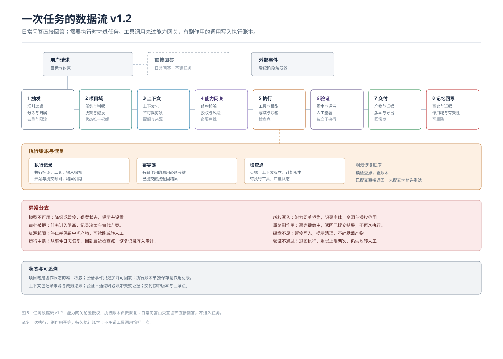
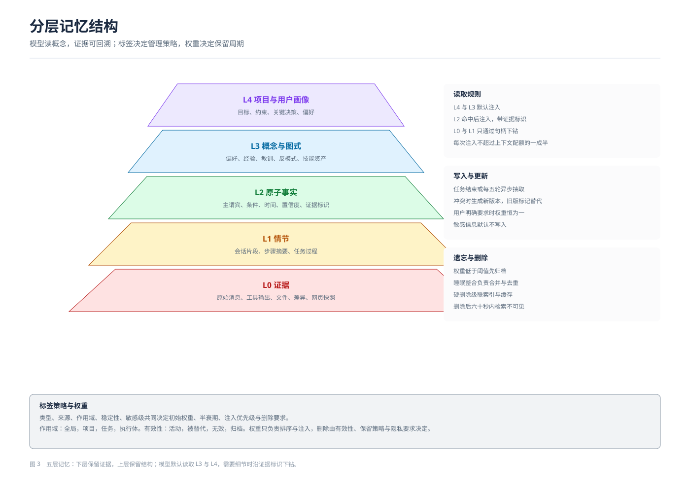

# 万象超级智能体设计说明书

版本 v1.2　发布日期 2026 年 11 月 8 日　维护者 项目组

## 一、阅读指南

本说明书说明万象超级智能体的设计。内容包括产品定位、总体架构、生命周期、项目与状态模型、任务范式、协作机制、上下文与记忆、工具与模型接入、治理边界、可演进性与第一阶段交付范围。文字面向开发者与项目干系人，每项设计都说明它解决什么问题，以及与其他部分如何衔接。

第一次接触本项目，建议按第一章至第三章了解定位与骨架，再读第四章与第五章理解运行方式。需要评审设计时，重点看第七、九、十二章。需要排期或验收时，看第十三、十四章。

文中出现的编号有固定含义。DEC 开头为已确认决策，ADR 开头为架构决策记录，M01 至 M18 为范围模块，M0 至 M6 为协作模式，MM1 至 MM4 为记忆子系统里程碑，M-001 这类编号为任务卡。

## 二、项目定位

### 2.1 一句话定位

万象超级智能体是一个开源的个人智能体工具。用户在自己的机器上运行，使用自带的模型接口与密钥，不依赖云端账号，也没有多租户与计费系统。它围绕项目工作：用户提出目标，智能体完成问询、规划、执行、验证与交付，过程以项目图呈现。

### 2.2 目标用户与场景

第一阶段面向个人开发者与独立创作者。典型工作包括资料研究与对比、代码修改与测试、文档撰写、数据处理与页面制作。用户通常同时推进少量项目，希望把重复的检索、整理、执行与验证交给智能体，自己保留目标设定与验收判断。

### 2.3 与聊天式助手的分界

第一，状态按项目组织，跨会话保留目标、任务、产物与决策。第二，交付物是一等公民，带有版本、证据与来源，可以预览、下载与回退。第三，过程默认折叠为进度视图，聊天记录退到节点详情里。用户不必阅读整段对话，也能判断做到哪一步、卡在哪里、需要自己做什么。

### 2.4 第一阶段不做什么

不做通用聊天陪伴，不做开放桌面或网页的自主操作，不引入自由多智能体拓扑，不做企业级权限体系，不做多租户与计费，不自研基础模型。这些边界写入范围文档，目的是让第一阶段收敛。

## 三、设计原则

1. 先证据，后结论。事实性内容可以回到原始证据，没有证据的推断不进入长期记忆。
2. 上下文是配额，不是仓库。注入内容受配额约束，能放句柄就不放全文。
3. 状态外置，事件追加。会话与项目状态都可以回放，压缩只生成视图，不删除事实。
4. 统一执行契约。内置工具、外部协议与代码执行都走同一个调用入口。
5. 能力走契约。记忆、项目、协作、模型与界面都通过接口交互，后端可替换。
6. 默认只读，越权必审批。写文件、付款、对外发送三类动作需要人确认。
7. 模型可见即可追溯。进入模型请求的内容必须能从日志或项目域重建。
8. 外部验证优先。用测试、校验与工具返回值校正判断，模型自评只作参考。
9. 资源与停止条件是机制。运行时长、步数与重试上限由代码执行，不依赖提示词自律。
10. 升级要有证据。契约测试、回放回归与对照实验通过后，改动才进入默认路径。

## 四、总体架构

### 4.1 分层职责

| 层 | 职责 | 不承担 |
|---|---|---|
| 体验层 | 呈现项目结构、进度、产物与待办，接收用户操作 | 保存状态、执行任务 |
| 状态层 | 保存项目域、会话事件、证据索引与执行账本，提供回放、恢复与溯源 | 业务判断 |
| 决策层 | 选择协作模式、编排执行、组织验证 | 具体工具调用 |
| 能力层 | 装配上下文、检索记忆、执行工具、调用模型，经能力网关授权 | 产品状态管理 |
| 保障层 | 治理、审计、资源上限、可观测性、可演进契约与数据生命周期 | 业务功能 |

层与层之间只通过契约交互。上层不直接读写下层存储，下层不假设上层如何展示。替换模型供应商、记忆后端或界面时，改动被限制在对应层内。

### 4.2 模块清单

| 编号 | 模块 | 第一阶段形态 | 后续 |
|---|---|---|---|
| M01 | 任务会话与执行 | 目标、计划、执行、交付，支持暂停与回放 | 多级续跑 |
| M02 | 事件日志 | 只追加会话事件，项目审计独立成域 | 跨设备同步 |
| M03 | 规划与循环 | 单 agent 循环，四类停止条件 | 策略库 |
| M04 | 工具层 | 统一执行入口，内置工具与协议适配 | 工具市场 |
| M05 | 执行环境 | 系统级本地隔离，网络默认拒绝 | 云沙箱 |
| M06 | 记忆子系统 | 五层结构，显式读写删，可关闭 | 权重与睡眠整合 |
| M07 | 交付与交互 | 图谱、看板、收件箱、产物双视图 | 时间线视图 |
| M08 | 安全与审批 | 默认只读，三类审批，审计 | 企业权限 |
| M09 | 评测与回归 | 基线任务集与指标口径 | 自动回归 |
| M10 | 资源与限制 | 时长、步数与重试上限 | 自适应配额 |
| M11 | 项目容器 | 项目、任务、产物、审批与审计 | 项目模板 |
| M12 | 模型网关 | 自带密钥、三档映射、降级 | 内置供应商 |
| M13 | 自适应协作 | 规则选择模式，决策审计 | 多级拓扑 |
| M14 | 可演进性 | 契约测试与升级演练 | 自动迁移 |
| M15 | 阶段化生命周期 | 问询、任务、交付、迭代 | 阶段模板 |
| M16 | 任务范式与技能 | 六类范式，技能包可插拔 | 自定义范式 |
| M17 | 事件驱动运行时 | 项目事件与定时触发 | 外部事件、远程运行时 |
| M18 | 发布与收口 | 唯一旅程、六态、交付清单 | 自动发布 |
| M19 | 执行账本与恢复 | 副作用记录、幂等键、检查点与崩溃恢复 | 跨进程后台任务 |
| M20 | 可观测性 | 项目至工具链路追踪，默认不记录敏感原文 | 指标看板 |

### 4.3 状态归属

项目域保存任务、产物、审批、台账与审计，是协作状态的唯一权威。会话事件保存执行轨迹，只追加并可回放。记忆域保存跨会话的知识与证据。产物索引保存文件句柄、哈希与来源。界面只读项目域投影，操作通过命令入口写入。

### 4.4 三个运行循环

系统内部有三个生命周期独立的循环，共享项目状态。

| 循环 | 输入 | 输出 | 生命周期 |
|---|---|---|---|
| 交互循环 | 用户自然语言、项目状态 | 直接回答、创建任务、修改任务、澄清请求 | 单轮或短会话 |
| 执行循环 | 任务与上下文包 | 运行、产物、证据 | 跨步骤，可暂停恢复 |
| 学习循环 | 事件、产物与运行结果 | 记忆写入、合并、失效与删除 | 异步批处理 |

日常问答只经过交互循环，不创建任务。只有需要执行或修改项目的请求才进入任务阶段。执行循环负责规划、工具调用、检查点与验证。学习循环负责把结果沉淀为可复用的记忆。

## 五、生命周期

### 5.1 阶段与门禁

| 阶段 | 目标 | 门禁 |
|---|---|---|
| 问询 | 讲清目标、非目标、判据、约束与参考 | 目标可复述，至少一条客观判据，排除清单非空 |
| 任务 | 把计划执行成可验收的产物 | 任务完成或显式放弃，产物带证据，无未处理阻塞 |
| 交付 | 确认可用、可维护、可回滚 | 验收通过，交付清单齐全，回滚方式可用 |
| 迭代 | 基于已有资产快速再启动 | 差异任务完成，回归通过，继承率达到约定值 |

交互循环先判断意图。日常问答直接回答，不创建任务；只有需要执行或修改项目的请求才进入下表的流程。

问询阶段每轮最多三个会改变计划的问题，用户可以说“你决定”。任务阶段是主要工作期，用户看到图谱、看板、收件箱与节点详情。交付阶段整理交付物与维护说明。迭代阶段继承 Brief、规格、记忆、产物与任务基线，只执行差异任务。

### 5.2 状态机

项目状态包括草案、问询、规划、执行、暂停、验证、已交付、迭代与归档。任务状态包括待办、就绪、已分配、执行中、等待输入、验证中、完成、失败、阻塞与取消。运行状态包括排队、准备、执行、暂停、成功、失败、资源停止、取消与超时。产物状态包括草稿、候选、已验证、已交付与退回。审批状态包括请求、批准、拒绝与过期。

每次状态迁移都写入项目事件，携带原因与操作者。非法迁移被拒绝，接口返回结构化错误。

### 5.3 任务阶段的操作

用户可以删除任务，取消下游依赖，已产物保留并标注。可以改进任务，修改目标与判据后重跑，旧运行保留。可以插入功能，新增任务并入任务图并重算关键路径。可以改派角色或模型，也可以直接接管产物。所有操作写入审计，并给出影响评估，包括下游任务数、关键路径变化与预计时长。

## 六、项目域与数据模型

### 6.1 核心实体

项目包含名称、目标、状态、工作区、预算与审计。目标描述阶段性结果。任务是最小执行单元，包含目标、判据、角色、依赖、资源上限与证据。运行是一次尝试，绑定执行者、模型、工具调用与成本。产物是文件或报告，带版本、哈希与来源。审批记录动作、风险、证据与决策。

### 6.2 数据与迁移

会话事件沿用基座格式，新增事件通过声明合并扩展，旧读端可以跳过。业务存储使用带版本号的存储域，升级时生成新版本并执行迁移函数。导出包包含项目、任务、产物、记忆与审计，导入时校验版本并重建索引。删除项目会级联清理项目域、记忆命名空间与索引，保留删除审计元数据。

### 6.3 台账

项目域维护任务台账与进度台账。任务台账记录事实、假设与计划。进度台账记录每一步是否在推进，连续无进展时触发重规划。台账对用户可见，用于解释智能体为什么做出某个判断。

## 七、任务范式与协作

### 7.1 两个正交维度

任务类型决定做法，协作拓扑决定由谁来做、并行多少。研究类任务默认多源检索与交叉验证，代码类任务默认读现状、最小改动与回归。拓扑从单执行与协调者开始，只有出现独立子任务或上下文压力时才升级。

### 7.2 六类任务范式

| 类型 | 默认步骤 | 主要验收 |
|---|---|---|
| 调研 | 澄清问题、多源检索、交叉验证、结构化结论 | 来源可打开，结论有证据 |
| 代码 | 读现状、定位、最小改动、测试、回归 | 测试转绿，回归通过 |
| 文档 | 大纲、素材、初稿、校对、来源与术语表 | 评审通过，来源齐全 |
| 数据 | 读入、清洗、计算、校验、图表 | 口径与公式可以复核 |
| 设计 | 需求、参考、方案与原型、评审 | 走查表与截图 |
| 运维 | 诊断、变更计划、执行、验证、回滚点 | 冒烟通过，回滚演练完成 |

### 7.3 协作模式

默认采用最小充分范式。M0 为单执行，适合单产物少步骤的任务。M1 为协调者，适合中等任务。M2 为黑板状态模型与均匀扇出，适合多个独立子任务。M3 为固定流水线，适合流程稳定的工作。M4 为两级扇出，最多两级，不设子主管。M5 辩论只用于离线复核。M6 为人工，处理不可逆或合规判断。

协调策略层读取产物数量、可分解性、预估步数、领域广度、判据清晰度、风险、写域冲突与资源余量，输出并行度、隔离级别、人工闸门与模式标签。模式进入默认路径前需要同任务集的重复实验证据。

### 7.4 交接契约

子执行体只接收一次任务说明，包含目标、输入、判据、工具白名单、权限、资源上限、已确认决策、假设、禁止事项与返回契约。返回结果包含摘要、产物句柄、证据、失败项与用量。子执行体不回多条消息，不直接对用户说话，不直接写主线产物。

## 八、上下文管理

### 8.1 上下文包

每次任务执行前，上下文装配器生成临时上下文包，内容包含任务目标、验收判据、相关产物句柄、检索到的记忆卡、已确认决策与假设、禁止事项，以及最近事件摘要。上下文包带配额与来源记录，执行结束后折叠为结论、判据与证据句柄，不写入会话历史。

工具调用先经过能力网关，依次校验结构、授权范围与风险，必要时请求审批。有副作用的调用写入执行账本，带幂等键。崩溃后先读检查点，再查账本，已提交的记录直接返回结果，不重复执行。

### 8.2 装配与裁剪

装配顺序为：读取任务与项目状态，检索记忆，取相关产物，整理决策与假设，按优先级装包。优先级从高到低依次为判据、约束与决策、产物、事件、背景。超过配额时按优先级裁剪，并记录裁剪原因。

### 8.3 折叠与压缩

子任务完成后，执行过程折叠为结论、判据与句柄，父级只接收折叠结果。需要细节时按句柄下钻。摘要压缩用于无法折叠的内容，属于兜底手段。压缩只生成视图，原始事件保留。压缩不得丢弃验收判据、用户约束、活动决策、未完成步骤、失败证据、审批状态、产物引用与检查点引用。

### 8.4 缓存与布局

稳定内容放在前缀，包括身份、规则、项目章程与工具目录。动态内容放在末尾，包括检索结果、工具结果与时间戳。缓存断点只打在前缀边界，并记录缓存读取量与断裂次数。

## 九、记忆系统

### 9.1 分层

L0 保存原始证据，包括消息、工具输出、文件、差异与网页快照。L1 保存会话片段与步骤摘要。L2 保存可以独立理解的事实，带条件、时间与置信度。L3 保存跨事实归纳出的概念、经验与教训，并单独管理技能、知识条目与代码图三类资产。L4 保存项目与用户画像。

模型默认读取 L3 与 L4，L2 在命中当前问题时注入，L0 与 L1 只通过证据标识下钻。

### 9.2 标签与策略

类型、来源、作用域、稳定性与敏感级共同决定初始权重、半衰期、注入优先级与删除要求。类型包括偏好、约束、决策、事实、事件、经验、教训、意图、实体与临时记录。来源包括用户明确陈述、工具观测、模型推断与外部文档。敏感信息默认不写入，需要用户显式授权。

作用域分全局、项目、任务与执行体。项目记忆默认不因语义相似自动跨项目共享，跨项目复用需要显式策略。每条记忆同时带有效性状态与记录时间、生效时间、失效时间。有效性决定是否注入，保留策略决定保留多久，热度只影响排序。用户要求记住表示更强的保留承诺，不表示内容永远正确。

### 9.3 权重与衰减

记忆强度等于内在重要性乘以时间衰减因子，再乘以冲突压制因子。内在重要性由类型基准、来源系数与置信度决定。时间衰减因子按半衰期指数下降。被有效使用时强度回升，被新事实替代时强度下降。用户明确要求记住的内容权重恒为一，不参与衰减。

权重变化会改变保留周期，也会改变对象处在热、温、凉、冷、归档哪一层。权重低于阈值时先归档，长期未用且无引用时清理索引，隐私删除走独立路径。

### 9.4 写入与读取

写入触发点包括任务结束、每五轮对话、上下文压力、用户明确要求、工具关键结果与决策点。写入过程包括调度、抽取、去重与冲突判定、落库、实体链接与索引更新。读取采用向量、全文与实体三路召回，先融合再精排。注入前对同一主谓只保留最新版本，旧版本折叠为历史值。

### 9.5 遗忘与删除

软遗忘把低权重记忆移出默认注入，归档保留索引与证据。硬删除级联清理主记录、索引、嵌入与缓存，删除后短时间内不可检索。删除操作写入审计，但不保留内容。

## 十、工具与模型

### 10.1 统一执行契约

所有工具通过同一个调用入口执行，参数先校验，再判定权限与审批，再进入沙箱或远程执行，结果归一化后返回。工具声明名称、说明、输入输出结构、风险等级、审批策略、超时与信任级别。

### 10.2 权限与审批

权限采用能力授权。用户或项目可以授予某一能力在特定资源范围、特定时间内的使用权，例如项目工作区内的写入。已授权范围内的写操作可以连续执行，不需要每次确认；越界写、删除、覆盖关键文件、付款与对外发送需要审批。权限判断在可信代码中完成，模型不能自行授权。外部内容默认不可信，不直接驱动高权限工具。密钥只保存在本地凭据存储，不进入沙箱与日志。

### 10.3 协议与代码执行

外部工具通过协议适配接入，按请求携带版本与能力，不依赖长期会话。多步数据处理可以下沉到沙箱代码执行，只回传最终结论，中间结果留在沙箱。

### 10.4 模型接入

模型访问采用自带密钥的方式，用户填写请求地址、密钥、协议与三档模型映射。保存前做连通性测试。运行中按角色选择档位，主模型不可用时按降级链切换，连续失败时升级模型或转人工。系统记录用量，不换算金额。

## 十一、治理与安全

系统默认只读。写文件、付款、对外发送三类动作需要人工确认。网页、文档与第三方工具返回的内容一律视为不可信。工具白名单、最小权限、全量审计与资源上限共同构成边界。

资源上限按次运行计算。单次运行有时长、步数与重试上限，超限后停止并保留中间产物。用户与模型服务商之间的费用关系在系统之外处理。数据默认保存在本机，支持导出、导入与删除。删除会级联清理派生数据。

## 十二、可演进性

### 12.1 四层契约

内核契约冻结，包括会话事件、工具执行接口与上下文装配钩子。产品服务契约版本化，包括记忆、项目、协作、上下文与网关。适配器可替换，包括模型、工具、沙箱、存储与记忆后端。边缘可替换，包括协议适配、界面与远程控制传输。

### 12.2 扩展点

| 扩展点 | 接入方式 | 是否改内核 |
|---|---|---|
| 模型供应商 | 新适配器包与网关配置 | 否 |
| 工具与协议 | 注册工具或协议适配器 | 否 |
| 沙箱 | 新执行提供方 | 否 |
| 记忆后端 | 新存储提供方与迁移 | 否 |
| 协作策略 | 注册新模式 | 否 |
| 界面 | 客户端插件与投影 | 否 |
| 远程控制 | 新增宿主服务与客户端 | 否 |
| 图形界面操作 | 工具提供方，默认关闭 | 否 |

### 12.3 升级流程

升级依次经过契约测试、影子运行、回放回归、对照实验、灰度与默认启用。迁移不可逆时先备份并保留回滚步骤。没有证据的升级不进入默认路径。

## 十三、第一阶段范围与发布判据

第一阶段只保证一条窄而完整的旅程：安装并配置模型接口，建立项目，完成问询与计划，执行若干任务，验证并交付产物，随后可以导出或删除。

| 维度 | 判据 |
|---|---|
| 旅程 | 上述流程可以完整走通，没有死路 |
| 界面状态 | 七个核心界面具备空态、加载、错误、成功、无权限与离线状态 |
| 数据 | 导出、导入、删除往返测试通过 |
| 异常 | 模型不可用、沙箱失败、审批被拒、资源超限、运行中断、磁盘不足、升级失败七类用例通过 |
| 交付物 | 安装与启动说明、快速开始、配置示例、示例项目、许可证与第三方通告、版本与变更记录、回滚说明、诊断包 |
| 性能 | 首屏不超过两秒，两百节点图谱不超过一秒，操作反馈不超过一秒 |
| 安全 | 密钥不外泄，五类攻击用例全部拦截 |
| 恢复 | 崩溃前后各一次，恢复后不重复已提交副作用，并说明已完成与下一步 |
| 账本 | 有副作用工具调用均有执行记录与幂等键 |

第一阶段的范围有意收窄。记忆只做最小闭环，任务范式只做调研与代码两类，事件驱动运行时与黑板视图放到后续阶段。收窄的目的是让完整度可验收，而不是追求功能数量。

## 十四、路线图

| 阶段 | 目标 | 主要内容 |
|---|---|---|
| P1a | 走通骨架 | 项目域最小版、问询表单、单任务执行、列表与简化任务图、节点详情、模型接入、本地隔离、导出 |
| P1b | 完整 v1 | 图谱与看板、记忆最小闭环、生命周期完整、七界面六态、交付清单、发布收口 |
| P1.5 | 协作增强 | 模式领取与租约、事件驱动运行时、看门狗、黑板视图 |
| P2 | 桌面与远程 | 三平台客户端、远程运行时与配对鉴权 |
| P3 | 移动控制 | 移动端远程控制，只做控制端 |

## 十五、风险与待决

主要风险包括：范围偏大导致第一阶段延期；记忆系统复杂度过高；协作模式缺少自家对照实验；文档与实现漂移；本地隔离的强度有限。缓解方式分别是拆分交付、只做最小闭环、设置实验门槛、把文档检查纳入门禁、在发布前做威胁评估。

仍待决定的问题包括：项目与代码仓库的对应关系；项目模板是否进入第一阶段；项目数据可移植性的边界；后续是否内置常见供应商预设。

## 十六、术语表

| 术语 | 含义 |
|---|---|
| 项目域 | 项目协作状态的权威存储，也称黑板 |
| 会话事件 | 只追加的执行轨迹，可以回放 |
| 上下文包 | 为单次任务临时组装的上下文集合 |
| 协调策略层 | 根据任务规模与证据选择协作模式的组件 |
| 任务范式 | 某一类任务的标准做法 |
| 协作拓扑 | 单执行、协调者、黑板、流水线等执行组织方式 |
| 台账 | 任务台账与进度台账，记录事实、假设与推进情况 |
| 证据 | 支撑结论的原始材料或可访问来源 |
| 资源上限 | 运行时长、步数与重试次数的硬限制 |
| 可演进契约 | 内核冻结、四层分级与升级证据的合称 |

## 十七、文档索引

治理文档位于 .ome 目录，包括立项书、范围、需求规格、任务图、总体设计、决策登记、状态与交接。设计文档位于 .ome/design，共十份。任务卡位于 .ome/tasks。调研材料位于 .ome/research，覆盖记忆、市场、基座扩展点、前沿方法与文档审计。评测集与指标口径位于 .ome/evals。架构决策记录位于 docs/adr，共九份。

本说明书的图源文件与正文位于同一目录，图形采用 SVG 格式，可以在浏览器中打开，也可以用于演示与打印。图 1 另附可编辑 PPTX，位于 vivid/delivery。可执行契约位于 .ome/contracts，包含项目状态、运行循环、上下文装配、记忆生命周期与能力授权五份文档。
