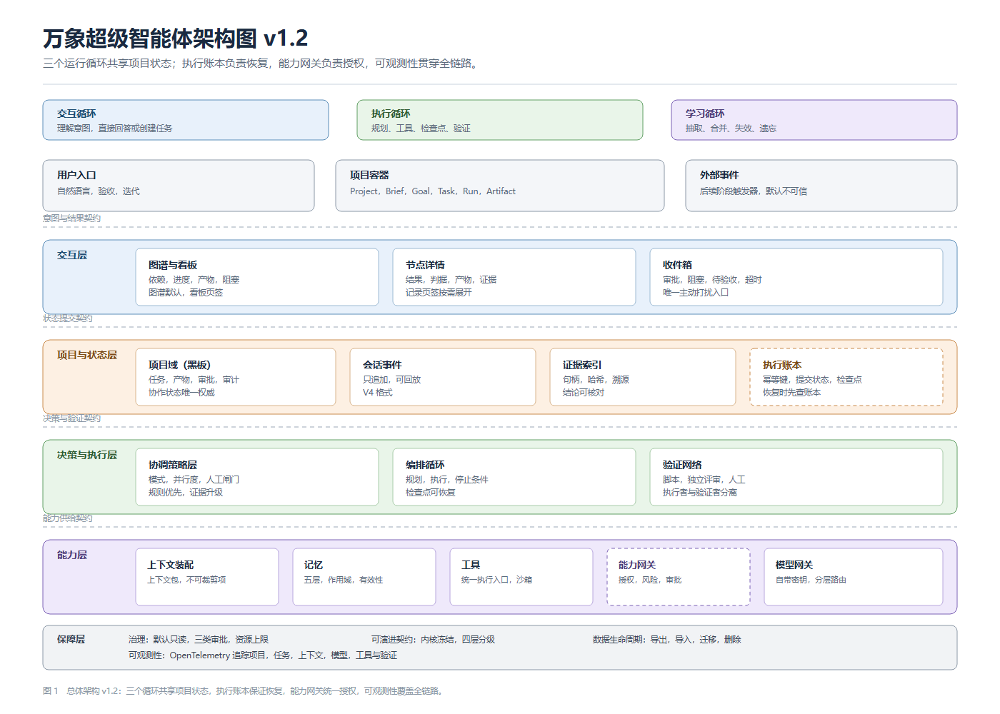
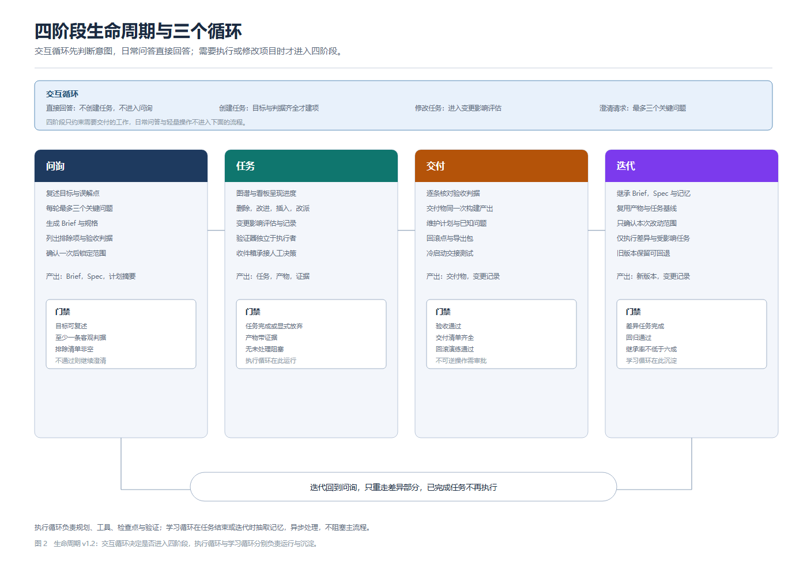
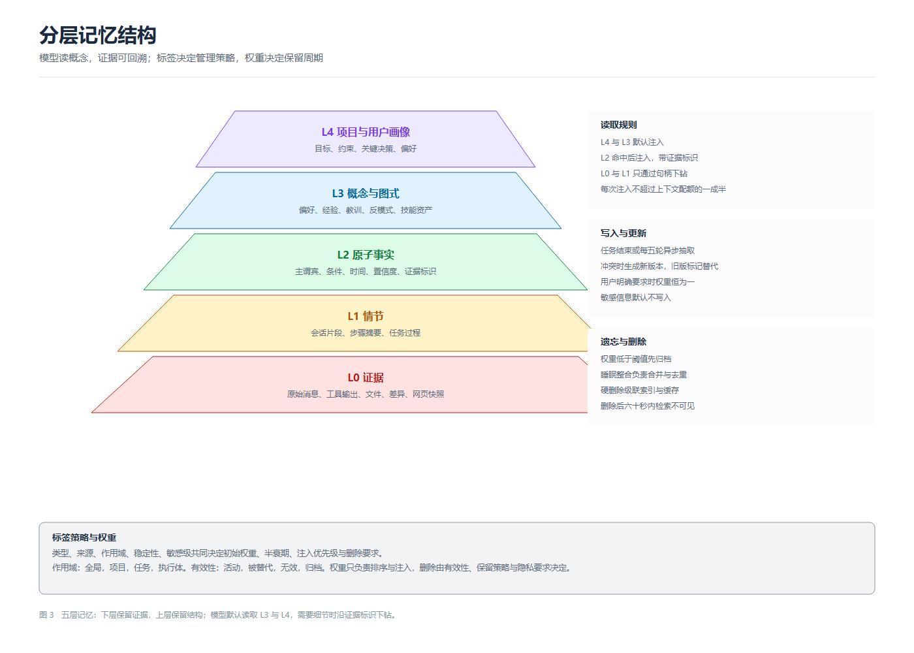

  
  <h1>Panoptic Super 万象超级智能体</h1>
  
开源自用，按项目管理，图优先，可演进

  

    <code>MIT</code>
    <code>TypeScript</code>
    <code>DeepSeek Harness</code>
    <code>设计版本 v1.2</code>
  

Panoptic Super 是一个开源的个人超级智能体。它运行在用户自己的机器上，使用自带的模型接口与密钥，不依赖云端账号，也没有多租户与计费系统。

它不把聊天记录当作主界面。用户提出目标，系统建立项目，完成任务拆解、执行、验证与交付，整个过程以项目图呈现。第二天重新打开程序，智能体依据项目状态与记忆继续工作，不需要用户重复解释。

## v1.2 修订

设计说明书 v1.2 对外部评审与技术报告做了回应，落地了四项结构调整。

| 变化 | 说明 |
|---|---|
| 三个运行循环 | 交互循环负责理解意图与直接回答，执行循环负责任务与工具，学习循环负责记忆沉淀。三者共享项目状态，生命周期独立 |
| 执行账本与恢复 | 有副作用的工具调用记录幂等键与提交状态。崩溃后先查账本，不重复已提交的写操作 |
| 能力授权 | 项目工作区内已授权的写操作可以连续执行。越界写、删除、付款与对外发送仍需审批 |
| P1 收口 | 第一阶段只验证一条可恢复的闭环，其他模块实现最小接口 |

执行语义写为至少一次执行、副作用幂等、持久执行账本，不承诺工具调用恰好一次。详细决策见 [ADR-0010](docs/adr/ADR-0010-runtime-loops-and-execution-ledger.md)，可执行契约见 [.ome/contracts](.ome/contracts/README.md)。

## 总体架构

架构分五层。体验层呈现项目结构、进度与待办。状态层保存项目域、会话事件与证据索引。决策层选择协作模式、编排执行与验证。能力层负责上下文装配、记忆、工具与模型接入。保障层处理治理、审计、资源上限与可演进契约。

项目域是协作状态的唯一权威。会话事件只追加并可回放。界面只读项目域投影，操作通过命令入口写入。

## 生命周期与记忆

<table>
  <tr>
    <td width="50%"></td>
    <td width="50%"></td>
  </tr>
  <tr>
    <td align="center">问询、任务、交付、迭代四个阶段，阶段之间有门禁</td>
    <td align="center">证据、情节、事实、概念、画像五层，模型读概念，证据可回溯</td>
  </tr>
</table>

生命周期只约束需要交付的工作。日常问答由交互循环直接处理，不创建任务。记忆按作用域分为全局、项目、任务与执行体，项目记忆默认不因语义相似跨项目共享。

## 第一阶段的闭环

P1 只保证一条窄而完整的旅程。

1. 安装并配置模型接口，完成连通性测试。
2. 用一句话建立项目，确认目标、判据与排除项。
3. 生成任务图，执行若干任务，产物带证据。
4. 验证后交付，保留回滚点。
5. 关闭程序，重新打开，恢复活动任务，说明已完成与下一步，不重复已提交的写操作。
6. 导出、备份或删除项目。

这条闭环拆成两段。P1a 先走通骨架，P1b 补齐六态、交付清单与发布收口。恢复与执行账本是发布门槛，不是后续优化项。

## 当前状态

| 基线项 | 结果 |
|---|---|
| pnpm run build | 10 项检查通过，耗时 63.38 秒 |
| pnpm run typecheck | 5 项检查通过，耗时 16.28 秒 |
| pnpm run test（core/session） | 574 个用例通过 |
| pnpm dsh web | 端口 3080，令牌鉴权返回 200 |

以上为基座仓库基线。本仓库复验任务记为 B-005，产品功能代码尚未开始。状态与交接信息见 [.ome/STATUS.md](.ome/STATUS.md) 与 [.ome/HANDOFF.md](.ome/HANDOFF.md)。

## 仓库结构

~~~text
packages/   基座包，以 @deepseek-ai/dsh- 开头
apps/       cli、desktop、desktop-host、web 等应用
vendor/     上游依赖的固定副本
native/     原生模块源码
python/     Python SDK 与运行时
docs/       基座文档、docs/adr 下的项目 ADR
.ome/       项目治理、设计、契约、调研、任务卡、评测与证据
scripts/    门禁脚本与评测校验脚本
~~~

基座代码以 squash 方式导入，未并入上游历史。本项目不跟进上游更新，遇到高危安全漏洞时人工评估是否移植。

## 文档地图

| 文档 | 内容 |
|---|---|
| [设计说明书](.ome/manual/manual.pdf) | v1.2，二十五页，含架构图与契约索引 |
| [可执行契约](.ome/contracts/README.md) | 项目状态、运行循环、上下文装配、记忆生命周期、能力授权 |
| [总体设计](.ome/DESIGN.md) | 分层、模块、决策与演进路线 |
| [范围](.ome/SCOPE.md) | 做与不做，模块验收 |
| [任务图](.ome/PLAN.md) | 任务卡、依赖与写域 |
| [决策登记](.ome/DECISIONS.md) | 已确认决策与重议条件 |
| [架构决策](docs/adr/) | ADR-0001 至 ADR-0010 |
| [评测集](.ome/evals/tasks.jsonl) | 基线任务与指标口径 |

## 本地运行

~~~sh
pnpm install
pnpm run build
pnpm run typecheck
pnpm run test
pnpm dsh web
~~~

开发运行时固定为 Node 24.15.0，由 `pnpm install` 安装到项目环境；用 `pnpm node --version` 确认版本后运行测试与构建，无需更改系统 Node。模型接口在首次启动时配置，密钥保存在本地凭据存储。

## 许可

本项目采用 MIT 许可，双版权归 DeepSeek 与山川不念旧所有。来源与导入方式见 [NOTICE](NOTICE)，第三方依赖通告见 [THIRD_PARTY_NOTICES.md](THIRD_PARTY_NOTICES.md)。
